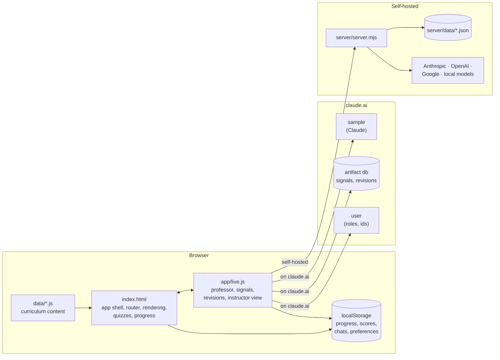
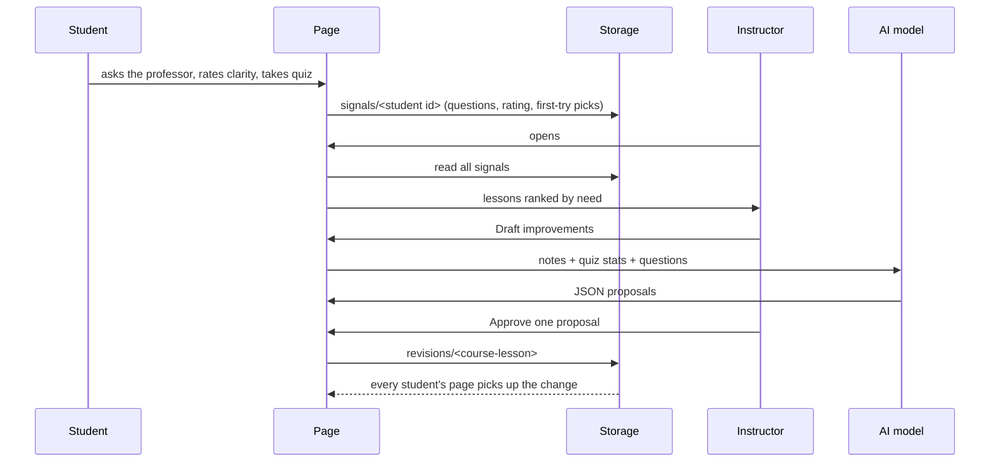

# Architecture

First Principles CS is a static single-page app with optional live features. The same files run in
three places: opened directly from disk, published as a claude.ai artifact, or served by the bundled
Node server. There is no build step and there are no dependencies.



## Files

| Path | Role |
|---|---|
| `index.html` | App shell: styles, routing, page rendering, code tabs, language selection, quizzes, progress. Written as an artifact body (no `<html>`/`<head>`); the server wraps it in a full document. |
| `data/program.js` | Defines `window.CSA`: the four-year plan, the source registry, source access labels, and the registration helpers. Loads first. |
| `data/<course>.js` | One file per course: `CSA.addCourse({...})`. |
| `data/cs101-extras.js` | Sidebars and optional lessons for CS 101, kept separate because they are long. Other courses keep theirs in the course file. |
| `data/cs101-code.js`, `data/cs102-code.js` | Auto-graded programming problems: `CSA.addCode("cs101", { unitId: [...] })`. PHYS 150 registers its few simulation problems at the end of its course file. |
| `app/code.js` | Programming problems: editor, Check/Run, results, solution and hint reveal, export script. |
| `app/pyworker.js` | Web Worker that loads Pyodide and runs the harness. |
| `app/harness.py` | The grader: runs student code and checks one test at a time. Also embedded in exported check scripts. |
| `vendor/pyodide/` | The Pyodide runtime, fetched by `scripts/get-pyodide.sh`; git-ignored. |
| `scripts/` | `get-pyodide.sh`, and `export_problems.js` + `check_problems.py`, which verify every problem. |
| `app/live.js` | Live features. Detects which backend is available and plugs into the app through hooks. |
| `server/server.mjs` | Self-hosted server: static files, model-provider proxy, JSON storage, instructor auth. |
| `server/config.example.json` | Template for `server/config.json` (git-ignored). |

Scripts load in this order: `data/program.js`, the course files, the inline app script in
`index.html`, then `app/live.js` and `app/code.js`. The app renders immediately; live features
appear once `live.js` finds a backend, and Python starts the first time a student checks or runs code.

## Programming problems

A problem in `data/cs101-code.js`:

```js
{
  id: "leap_year", title: "Leap years",
  prompt: `<p>Write <code>is_leap_year(year)</code> ...</p>`,
  starter: `def is_leap_year(year):\n    pass\n`,
  hint: `<p>...</p>`,
  solution: `def is_leap_year(year): ...`,
  tests: [
    { label: "2024 is a leap year", call: "is_leap_year(2024)", expect: "True" },
    { label: "2100 is not", call: "is_leap_year(2100)", expect: "False", hidden: true }
  ]
}
```

| Test `type` | Fields | Passes when |
|---|---|---|
| `call` (default) | `call`, `expect` (Python expressions) | The call's result equals the expected value (floats compared with a tolerance, also inside lists, tuples and dicts) |
| `io` | `stdin` (list of lines), `expect` | The whole program, with `input()` fed from `stdin`, prints exactly `expect` (trailing spaces and blank lines ignored; prompts aren't counted) |
| `raises` | `call`, `error` | The call raises that exception type |
| `assert` | `code` | The Python in `code`, run with the student's names in scope, raises no AssertionError; its message is shown on failure |
| `source` | `code` | Same, but only `__source__` (the program text) is available and the program isn't run: "doesn't use `max`" checks |

Any test can add `setup` (Python run first, for example to create a file), `hidden: true` (the
student sees that it failed but not the details) and `limit` (seconds, default 5).

**How a check runs.** `code.js` starts `app/pyworker.js` on the first Check or Run. The worker loads
Pyodide from `vendor/pyodide/` (or, if that's missing, from the jsDelivr CDN), writes `harness.py`
into Python's virtual file system and imports it. Each test is sent separately with a timer; if a
test exceeds its limit, the worker is terminated, the test is reported as too slow or an infinite
loop, and a fresh worker starts for the next test. Tests are visible in the page source, so this
is for practice, not for graded exams.

**Results** are kept per browser (`fpcs:solved`, and the code itself in `fpcs:draft:<course>-<id>`),
and reported to the improvement loop: each student's signal document records, per problem, the
number of checks until solved and whether it was solved. The instructor view shows each problem's
solve rate, and flags a lesson when fewer than half of at least three students solve a problem.
The professor sees the problems and reference solutions, with instructions never to write out a
solution, and each problem has an "Ask the professor" button that sends the student's code and the
failing tests.

**Run on my computer** builds a single Python file: the harness, the student's current code and the
tests, with time limits enforced after each test. It needs only Python 3.

**Checking the problems themselves:** `node scripts/export_problems.js > /tmp/p.json` then
`python3 scripts/check_problems.py /tmp/p.json` verifies that every reference solution passes every
test and every starter fails at least one.

## Content model

All content is plain JavaScript objects. Notes are HTML strings (template literals).

Course and lesson ids must be lowercase letters and digits only (`c1`, `calchist`), because the
route pattern is `#c-<course>-<lesson>`. A term appears on the home page and in the sidebar when it
has `open: true` in `data/program.js`; several terms can be open at once.

```js
CSA.addCourse({
  id: "cs101", code: "CS 101", title: "Programming I",
  credits: 4, kind: "required",          // or "optional"
  term: "y1f",                           // a term id from program.js
  status: "planned",                     // optional: listed, but no notes yet
  languages: ["python"],                 // optional: overrides the term's languages
  summary: "...", prereqs: [], outcomes: ["..."],
  units: [{
    id: "u1", title: "...", minutes: 60, summary: "...",
    notes: `<h3>Section</h3><p>...</p>`,
    terms: [["Term", "Definition"]],
    quiz: [{ q: "...", choices: ["...", "..."], answer: 1, why: "...",
             langs: { java: { q: "..." }, cpp: { ... } } }],   // langs is optional
    sources: ["thinkpython", "mit6100l"]  // ids from CSA.sources
  }]
});

CSA.addAsides("cs101", {                 // sidebars inside core units
  u1: [{ kind: "history", title: "...", html: `<p>...</p>`, sources: ["..."], only: "python" }]
});

CSA.addUnits("cs101", [ /* more units */ ]);   // append units; lets a long course span several parts

CSA.addOptional("cs101", [{              // optional lessons: a unit plus a kind
  id: "lang", kind: "history", title: "...", minutes: 75, summary: "...",
  notes: `...`, terms: [], quiz: [], sources: []
}]);
```

- **Rubric** (`course.rubric`), shown first on the course page: `assessments` (name, weight, desc;
  weights should total 100), `criteria` (name, desc, and four `levels` from Excellent to Beginning),
  `criteriaFor`, `scale` (grade, range pairs) and `policies` (HTML strings).
- **Practice** (`unit.practice`): a list of `{ q, hint?, a }` with HTML. Students see the problem and
  can reveal the hint and the answer. `course.practiceLabels` (`title`, `intro`, `answer`) renames the
  section, as the seminar does for discussion questions. The professor sees the problems and solutions
  and is told to give hints before solutions.
- **Sidebar kinds:** `history`, `ethics`, `lang` (language evolution), `practice`.
- **Optional lesson kinds:** `history`, `ethics`, `deep` (deep dive).
- **Sources:** every id must exist in `CSA.sources` in `program.js`. `CSA.access` labels each
  source `open`, `pd` (public domain), `free` (free to read) or `library`. Record a license only
  when the source states one on its own site.
- **Quiz answers** are 0-based indexes into `choices`. Keep existing questions in place and add new
  ones at the end: student results and approved rewrites are stored by question position.

### Notes markup

| Markup | Effect |
|---|---|
| `<h3>`, `<h4>` | Section and subsection headings. Clarifications attach after an `<h3>` by its exact text. |
| `<div class="callout">` | Highlighted box. |
| `<p class="note">` | Muted note, used for "Why it matters". |
| `<table>` | Wrapped automatically so wide tables scroll on phones. |
| `<pre><code>` | Code block labeled "Python". |
| `<pre data-label="Shell"><code>` | Code block with its own label (Terminal, Lean 4, HTML, ...). |
| `<figure class="fig"><svg>…</svg><figcaption>` | A diagram that follows light and dark mode. Inside the SVG use the classes `ax` (axes), `ln`, `cv` (main curve), `hl` (highlight), `dash`, `box`, `soft`, `warm`, `shade`, `bgf`, `outline`, `dot`, `hole`, and `text` with `m` (muted) or `code`. Give each figure's marker and clip-path ids a unique suffix. On phones a figure keeps a readable size and scrolls sideways. |
| `<div class="multi">` with `<pre data-lang="python">`, `"java"`, `"cpp"` | One example in several languages, shown as tabs. |
| `data-only="java cpp"` on any element | Shown only when one of the listed languages is active. |

Inside template literals, escape backslashes in code: write `"\\n"` to display `"\n"`, and use
`&lt;` and `&gt;` for `<` and `>`.

### Languages

`pref` is the student's chosen language (saved in `localStorage`); `lang` is the language actually
in use on the current page. `lang` is limited to the languages the course allows
(`course.languages`, else `term.languages`, else Python, Java and C++). Year 1 sets
`languages: ["python"]`, so the switcher is hidden, `.multi` blocks collapse to the Python version,
and `data-only` blocks, sidebars with `only` and quiz `langs` variants follow Python. The Java and
C++ material for CS 101 Unit 1 stays in the files for later courses to reuse.

## The app (`index.html`)

**Routing.** Views are chosen by the URL hash, which can be bookmarked and shared:

| Hash | View |
|---|---|
| (none) or `#home` | Home: the courses of every open term (`open: true` in `data/program.js`) and the four-year plan |
| `#c-<course>` | Course overview: core units, optional lessons, outcomes |
| `#c-<course>-<lesson>` | Lesson: notes, sidebars, key terms, clarity rating, quiz, sources |
| `#sources` | All sources, access labels and where each is cited |
| `#teach` | Instructor view |

**Rendering.** `render()` reads the hash, sets the active language, builds the view as an HTML
string, then for lessons runs `beforeEnhance` (inserts approved clarifications), `enhanceNotes`
(code tabs, code labels, table wrappers), and `wireUnit` (quiz and completion handlers).

**Browser storage.** Keys are prefixed `fpcs:`. Every read and write is wrapped so the app still
works when storage is unavailable.

| Key | Contents | Written by |
|---|---|---|
| `lang` | Preferred language | app |
| `done` | Completed lesson keys (`course-lesson`) | app |
| `scores` | Best quiz score per lesson | app |
| `chats` | Last 30 professor messages per lesson or course | live.js |
| `sid` | Anonymous student id (self-hosted only) | live.js |
| `model` | Chosen provider and model (self-hosted only) | live.js |
| `instructorKey` | Instructor key, until sign-out (self-hosted only) | live.js |

**Hooks.** The app exposes `window.FPCS` (content, helpers, `render`, `quizFor`, the current
language) and calls optional hooks that `live.js` registers on `FPCS.hooks`:

| Hook | When | Used for |
|---|---|---|
| `beforeEnhance(course, lesson, root)` | Before a lesson's notes are enhanced | Insert approved clarifications |
| `onClarity(course, lesson, value)` | Student rates clarity (+1 / −1) | Record a signal |
| `onQuiz(course, lesson, picks, quiz)` | Student submits a complete quiz | Record first-try and latest answers |
| `onRoute(route)` | After every render | Update the professor's context |
| `teach(root)` | The `#teach` view opens | Render the instructor view |

`quizFor(course, lesson)` returns the quiz the student sees: the base questions, with the active
language's `langs` variant applied, then any approved rewrite for that question position.

## Live features (`app/live.js`)

`live.js` picks one of two backends at load time, behind the same interface (`chat`, `json`,
`loadMine`, `saveMine`, `watchRevisions`, `loadSignals`, `writeRevision`):

| | claude.ai artifact | Self-hosted server |
|---|---|---|
| Detected by | `window.claude.use` exists | `GET api/config` succeeds |
| Model | Claude via `sample`, on the viewer's account | Any configured provider, chosen in the professor panel |
| Student identity | Platform user id | Random id per browser (`sid`) |
| Instructor | Artifact Editor (`user.canEdit()`) | Holder of `INSTRUCTOR_KEY` |
| Storage | Artifact `db` | `server/data/*.json` |
| Revisions refresh | Live (`onSnapshot`) | Polled every 60 s and on window focus |
| Professor tools | `get_lesson_notes` page tool, when supported | None (the catalog is in the prompt) |

If neither backend exists (for example a page opened from disk), the professor and the instructor
link stay hidden and nothing else changes.

### The professor

Each message sends a system prompt plus the last 16 turns of the conversation. The system prompt
holds teaching rules, the student's language, and, on a lesson page, the notes as plain text (up to
14,000 characters), the sidebars, approved clarifications, and the quiz with its answers. A rule
tells the model to give hints instead of answers until the student has submitted the quiz. Replies
stream in and are rendered with a small Markdown renderer that escapes all HTML first.

### The improvement loop



**Signal document**, one per student (`signals/<id>`):

```json
{ "lessons": { "cs101-u4": {
    "qn": 3,
    "qs": [{ "t": "why does factorial need a base case?", "at": 1793845119478 }],
    "clear": -1,
    "quiz": { "rev": 0, "first": [0, 2, 1], "last": [1, 2, 1], "tries": 2 } } },
  "at": 1793845119478 }
```

`qs` keeps the last 8 questions, each cut to 300 characters. `clear` is 1, −1 or 0. `quiz.first` is
the student's first complete attempt; it resets when `rev` changes.

**Revision document**, one per lesson (`revisions/<course>-<lesson>`):

```json
{ "clar": [{ "id": "c...", "after": "The recursive leap of faith", "title": "...", "body": "Markdown", "at": 0 }],
  "quiz": { "0": { "q": "...", "choices": ["...", "..."], "answer": 1, "why": "...", "at": 0 } },
  "quizRev": 1, "updatedAt": 0 }
```

Approving or removing a quiz rewrite increments `quizRev`, so first-try statistics restart for the
new wording. Model output is escaped before it is stored or shown: quiz text keeps only inline code
and bold, and clarifications go through the Markdown renderer.

**Needs attention** when a lesson has 3 or more student questions, or at least 2 "unclear" ratings
that equal or outnumber "clear" ones, or any quiz question under 60% correct on first try with at
least 3 attempts.

### claude.ai access rules

The artifact declares `sample`, `user`, and `db` with these rules:

| Path | Read | Write |
|---|---|---|
| (root) | Viewer | Editor |
| `signals` | Editor | Owner |
| `signals/{self}` | Contributor (own document only) | Contributor (own document only) |
| `revisions` | Viewer | Editor |

Students therefore need Contributor access to record their own activity, cannot read anyone else's,
and cannot change lessons.

## Self-hosted server (`server/server.mjs`)

A single file using only Node's standard library.

**Providers.** Each provider in the config has a `type` handled by an adapter that streams text:

| Type | API | Notes |
|---|---|---|
| `anthropic` | Messages API, `POST /v1/messages` | `x-api-key` header |
| `openai` | Chat Completions, `POST /chat/completions` | Also used for Ollama, LM Studio, vLLM and other compatible servers via `baseUrl`. `maxTokensField` and `jsonMode` per provider. |
| `google` | Gemini `streamGenerateContent?alt=sse` | `x-goog-api-key` header |

A provider is offered only if its `apiKeyEnv` variable is set, or if it needs no key. The server
merges consecutive turns from the same role and caps conversations at 24 turns.

**API.**

| Method and path | Who | Purpose |
|---|---|---|
| `GET /api/config` | Anyone | Enabled providers, models and the default |
| `POST /api/chat` | Anyone (rate limited); drafts need the instructor key | Streams a reply as server-sent events: `{"d": text}`, then `{"done": true, "truncated": bool}` or `{"error": code}` |
| `GET /api/instructor` | Anyone (10 tries a minute) | Checks an instructor key |
| `GET /api/signals` | Instructor | All student signal documents |
| `GET`, `PUT /api/signals/:sid` | The student's browser | Read or replace one student's signals |
| `GET /api/revisions` | Anyone | All approved revisions |
| `PUT /api/revisions/:key` | Instructor | Replace one lesson's revisions |

**Security.**

- API keys are read from environment variables and never sent to browsers.
- The instructor key is compared in constant time.
- Static files are served from an allowlist (`index.html`, `data/*.js`, `app/*.js`), so the
  server's own files and data are never served.
- The page is sent with a Content Security Policy that only allows the site itself and Google Fonts.
- Request bodies are size-limited (chat 300 KB, signals 64 KB, revisions 128 KB), and the number of
  student records is capped (`maxStudents`, default 5,000).
- Storage writes go to a temporary file that is then renamed, one at a time per file.

**Limits.** Students without the instructor key are rate limited per IP address (`rateLimit`,
default 10 questions a minute and 300 a day). Self-hosted students are anonymous per browser, so a
student on two devices counts as two.

## Design decisions

- **No build step and no dependencies.** Content authors edit a file and reload. The app runs from
  disk, on claude.ai and on the server unchanged.
- **Content as JavaScript, not JSON.** Notes contain a lot of HTML, and template literals keep it
  readable. It also lets the pages load from disk, where `fetch` of local JSON is blocked.
- **Two backends behind one interface.** claude.ai pages cannot contact other servers, so other
  model providers require self-hosting. Everything else is shared.
- **Human approval for changes.** AI-drafted revisions never reach students automatically, so a
  model's mistake cannot become course material without review.
- **Signals stored per student.** One document per student keeps storage bounded and lets each
  student write only their own record.

## Known limitations

- Quiz results are stored by question position. Language variants of a question share statistics,
  and an approved rewrite replaces every language's version of that question.
- Lesson progress and scores live in each browser and do not follow a student between devices.
- The professor does not run code itself; it sees the student's code only when they use "Ask the professor" on a problem.
- On claude.ai, programming problems depend on the page being allowed to start WebAssembly in a worker. If it isn't, each problem's "Run on my computer" script still works.
- Tests for programming problems are in the page, so a determined student can read them.
- Provider adapters were tested against mock APIs that follow each provider's documented streaming
  format. Test each provider with real keys before relying on it.

## Content review

Every new term gets at least one review cycle before it is called done. First, a student agent started with no context reads each course as plain text (`scripts/dump_course.js`) and lists everything unclear or blocking. Then a separate professor agent revises the content and answers each item. The reviews are kept in `docs/reviews/`, and the full procedure is in `CLAUDE.md`.

## Testing

There is no automated test suite yet. Changes so far were checked by:

- `node --check` on every script, and `scripts/validate_content.js`, which loads `data/*.js` in Node to validate references (every
  `sources` id exists, every quiz `answer` is in range, rubric weights total 100, SVG marker ids
  are unique, tags in notes are balanced).
- `scripts/lesson_time.js`, which estimates each core lesson's time (reading, quiz and practice) against its 90-minute budget.
- `scripts/test_dump_course.js`, which checks that the plain-text course extraction used by student review agents keeps superscripts, subscripts, blank lines in code, key terms, hints and bold symbols, and leaks no hidden Java/C++ or markup.
- `scripts/check_lesson_code.py` (with `extract_lesson_code.js`), which runs each lesson's Python blocks in order and flags lines whose actual output differs from the value their `# comment` claims. Review its output by hand.
- Recomputing every number in the math and physics lessons (worked examples, tables, simulation
  outputs) in Python.
- Driving the page in headless Chromium with Playwright, including a mock `window.claude` runtime
  for the claude.ai backend.
- Running the server against mock Anthropic, OpenAI, Gemini and local-model APIs.
- `scripts/check_problems.py` for every programming problem, and driving the problems in Chromium
  through the self-hosted server (its Content Security Policy included): starter fails, solution
  passes, an infinite loop is stopped, a slow algorithm fails its speed test, input programs and
  file problems work, and the exported script reports the same results.

Turning these checks into committed tests is a good next step.
